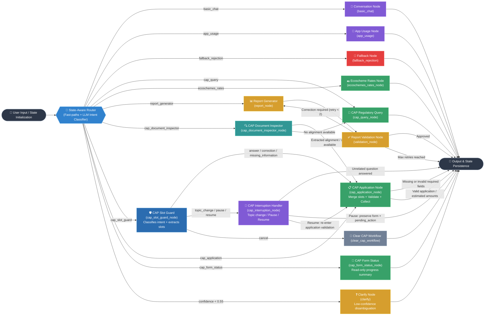

## 🧠 AgrIA Agentic Workflow Architecture

AgrIA uses a **LangGraph-driven stateful orchestration engine** that processes multi-modal agricultural queries, parcel visual metadata, and European Union / Spanish CAP (PAC) regulatory inquiries.

### 📐 Graph Topology Diagram



## 🏛️ Architecture & Component Breakdown

### 1. State Management (`AgrIAState`)
The agent maintains an immutable execution state passed between nodes:
* `messages`: Full conversation thread (`Annotated[list[BaseMessage], add_messages]`).
* `lang`: Target response language (`"es"` | `"en"`).
* `crop_metadata`: SIGPAC / GIS parcel JSON payload (if provided). Persists across report generations.
* `cap_form_data`: CAP slots collected across conversation turns, keyed by field name.
* `assessment_report`: Raw parcel assessment markdown string. Cleared when a new parcel is loaded.
* `pending_action`: Active interaction flow marker (e.g., `"AWAITING_SLOT:surface_ha"`).
* `cap_workflow`: Current stage in the CAP workflow (`"collect"` | `"assess"` | `"ready"` | `"paused"` | `"cancelled"` | `"unrelated"`).
* `cap_alignment`: Slot guard verdict for the latest user turn.
* `cap_rates`: Explicit EUR/ha rate table used to reproduce financial amounts.
* `visual_description`: Multi-modal VLM scene analysis.
* `correction_feedback`: Self-correction loop feedback for report generation.
* `report_retry_count`: Number of validation retries for the current report (max 2).
* `secondary_intent`: Secondary intent detected by the router (e.g., a user asking about rates *and* how to fill the form). Consumed by advisory nodes to address both concerns in one response.

**Intent Registry** (`INTENT_REGISTRY` in `state_models.py`): Single source of truth for the 10 valid router intents. The graph's `ROUTER_TARGETS`, the LLM classifier prompt, and the eval harness all derive from this set — adding a new intent requires one entry here plus a node and prompt.

---

### 2. Node Responsibilities

| Node Name | Module Path | Description / Scope |
| :--- | :--- | :--- |
| **Router** | `nodes/router_node.py` | Hybrid intent router. **Fast-paths** (zero LLM cost): `pending_action` slot continuation, `###DESCRIBE_*_IMAGE###` report triggers, empty messages. **LLM classifier**: structured JSON call with `INTENT.md` prompt (10 intents + `secondary_intent` + `confidence`). Routes to `clarify` when confidence < 0.55. Every decision is logged via `_log_routing()`. |
| **Basic Chat** | `nodes/basic_chat_node.py` | Handles general domain chit-chat, greetings, and high-level non-regulatory agricultural questions. |
| **App Usage** | `nodes/app_usage_node.py` | Helps with general use-of-the-tool questions and guides the user with step-by-step replies on how to engage properly with the app. |
| **Fallback** | `nodes/fallback_node.py` | Out-of-scope filter. Politeness rejection for queries unrelated to agriculture, crops, or farming. |
| **Clarify** | `nodes/router_node.py` | Deterministic (no LLM) disambiguation node. When the classifier's confidence is below threshold, asks one targeted question with multiple-choice options instead of guessing. |
| **CAP Document Inspector** | `nodes/cap_document_inspector_node.py` | Analyzes uploaded CAP application forms (PDF) to extract parcel alignment, slot details, and form attributes. Reuses `CAP_SLOT_GUARD.md` as system prompt. |
| **CAP Slot Guard** | `nodes/cap_slot_guard_node.py` | Classifies user intent within the CAP application flow (`answer`, `correction`, `pause`, `cancel`, `resume`, `topic_change`) and extracts slot values. 2 LLM attempts + deterministic fallback gated by schema. |
| **CAP Interruption Handler** | `nodes/cap_interruption_node.py` | Manages active application flow interruptions: topic changes (delegates to `basic_chat`, preserves form state), pausing, and resuming. |
| **CAP Application** | `nodes/cap_application_node.py` | Merges collected slots (schema-gated), validates required fields, asks exactly one next question, or - when valid - computes estimated CAP aid amounts from `CAP_RATES.json` and narrates the pre-calculated figures. |
| **CAP Form Status** | `nodes/cap_form_status_node.py` | Deterministic (no LLM) read-only node. Returns a structured summary of the current form: collected fields, pending field, workflow state. Does not mutate state. |
| **CAP Query** | `nodes/cap_query_node.py` | Local RAG pipeline powered by **ChromaDB**. Retrieves semantically relevant legal contexts from regional/national PAC regulatory PDFs and `.md` files. Preserves `pending_action` (does not abandon the form). |
| **Ecoscheme Rates** | `nodes/ecoscheme_rates_node.py` | Injects the language-relevant block from `classification.json` (ES or EN only, ~5.5 KB) for eco-scheme rates, financial thresholds, and payment tables. |
| **Report** | `nodes/report_node.py` | Generates comprehensive parcel diagnostic reports combining SIGPAC metadata and VLM visual descriptions. |
| **Validation** | `nodes/validation_node.py` | Deterministic (no LLM) report validator. Checks for markdown table presence and total area consistency. Bounded retry loop (max 2 attempts) before returning the last attempt. |
| **Clear CAP Workflow** | `nodes/router_node.py` | Utility node to reset `pending_action`, `cap_workflow`, and `cap_alignment`. Reached from the slot guard's `cancel` verdict. |
---

### 3. Vector Database & RAG Stack
* **Storage Engine**: Embedded ChromaDB (`VECTOR_DB_PATH`).
* **Embeddings**: Local ONNX / standard sentence-transformers (`all-MiniLM-L6-v2`).
* **Retrieval Mode**: Top-$k$ similarity search with metadata-preserved Markdown chunking (`RecursiveCharacterTextSplitter`).
 
---

## 🧪 Testing

Run the full automated pytest suite covering all graph execution paths:

```bash
cd AgrIA_server
uv run pytest test/ -vv
```

### Router Evaluation Harness

A dedicated eval harness (`test/agent/test_router_eval.py`) measures the intent classifier's routing precision against a labeled eval set (`router_eval_set.json`, 27 cases covering fast-paths, all 10 intents, multi-intent, and ambiguous messages):

```bash
# Offline mode (keyword-based classifier emulation, no API key needed)
uv run pytest test/agent/test_router_eval.py -v

# Live mode (real LLM classifier, requires LLM_API_KEY)
uv run pytest test/agent/test_router_eval.py -v --live
```